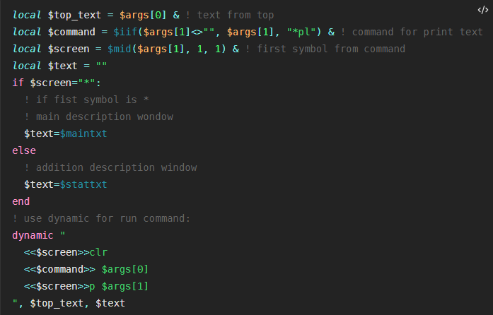
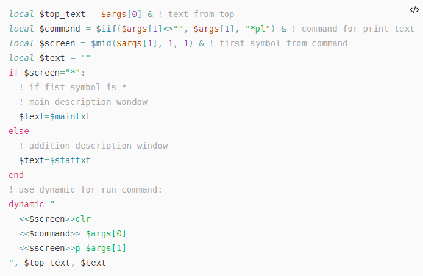

# QSP Syntax Highlighting for Obsidian

English | [Русский](README_RU.md)

Highlights fenced `qsp` code in [Obsidian](https://obsidian.md), in Reading view and the editor. This is a syntax highlighter, not a QSP player or syntax validator.

## Installation

Current release: **2.0.0**.

1. Download `qsp-syntax-obsidian.zip` from the [latest release](https://github.com/AleksVersus/qsp-syntax-obsidian/releases/latest), not GitHub's **Source code** archive.
2. Extract the `qsp-syntax-obsidian` folder into your vault's `.obsidian/plugins/` directory.
3. Check that `.obsidian/plugins/qsp-syntax-obsidian/` directly contains `main.js`, `manifest.json`, and `styles.css`, without an extra nested folder. When updating, replace these files with those from the same release.
4. Reload Obsidian. Open **Settings → Community plugins** and enable community plugins if needed.
5. Enable **QSP-syntax highlighting** under installed plugins.

## Usage

Use a fenced code block with the language identifier `qsp`:

````plain
```qsp
local $top_text = $args[0] & ! text from top
local $command = $iif($args[1]<>"", $args[1], "*pl") & ! command for print text
local $screen = $mid($args[1], 1, 1) & ! first symbol from command
local $text = ""
if $screen="*":
  ! if fist symbol is *
  ! main description wondow
  $text=$maintxt
else
  ! addition description window
  $text=$stattxt
end
! use dynamic for run command:
dynamic "
  <<$screen>>clr
  <<$command>> $args[0]
  <<$screen>>p $args[1]
", $top_text, $text
```
````





## Supported highlighting

- Ordinary and multiline comments, including comments after `:` and note text following `END`.
- Location headers/footers, labels, keywords, builtins, user calls, and typed system variables.
- Unicode identifiers, numbers, operators, punctuation, strings, and doubled-quote escapes.
- Bounded code-block/tuple matching and `<< ... >>` interpolation, including quoted `>>` in supported opposite-quoted expression literals.

## Limits and layout

- Location headers need a space or tab after `#`: use `# room`, not `#room`. Compact forms remain code.
- This plugin does not validate syntax or types. Recursive constructs are approximated; arbitrary nesting, complete multiline/incomplete-label styling, and escaped same-quote literals inside interpolation are not supported.
- `_` has no dedicated continuation-marker styling. Record fields retain generic variable/punctuation styling; `?` uses number styling.
- In Live Preview, inactive QSP blocks can appear as rendered widgets with an edit button, unlike Python's native editor lines. The current rendering behavior is retained.
- An extra blank/indented line above a QSP preview widget inside a list has been reported. It has not yet been independently reproduced or fixed; this is a layout issue, not evidence of incorrect QSP tokenization.

If highlighting does not appear, reload the plugin or note, or edit the code block. For a problem, [open an issue](https://github.com/AleksVersus/qsp-syntax-obsidian/issues) with the smallest reproducing **Markdown** example (including list indentation and fences), Obsidian/plugin versions, view mode, theme, and a screenshot. DOM excerpts alone may omit the source needed to reproduce layout problems.

## Development

Use Node.js 24 and install the locked dependencies:

```sh
npm ci
npm run typecheck
npm run lint
npm test
npm run build
```

`npm test` runs 887 scanner cases and 1,886 real-Prism cases. The 33 browser-native range tests require a separate harness described in [CONTEXT.md](CONTEXT.md); Node tests do not verify the full Obsidian UI. The build produces `main.js`; install it together with `manifest.json` and `styles.css` in a test vault and reload the plugin.

## Contact

- ask me: <lex666endless@gmail.com>, <aleksversus@mail.ru>
- "Subscribe my boosty": "[https://boosty.to/aleksversus](https://boosty.to/aleksversus)",

The first version of the plugin was based on [Svelte syntax highlighting](https://github.com/typhoon-kim/obsidian-svelte-syntax-highlighter) by Typhoon Kim. The plugin has since been completely rewritten from scratch, which is why I have removed his name from the license. Nevertheless, a huge thank you to Typhoon Kim! Go to [his page](https://github.com/typhoon-kim) and give this wonderful person all your money!!!
